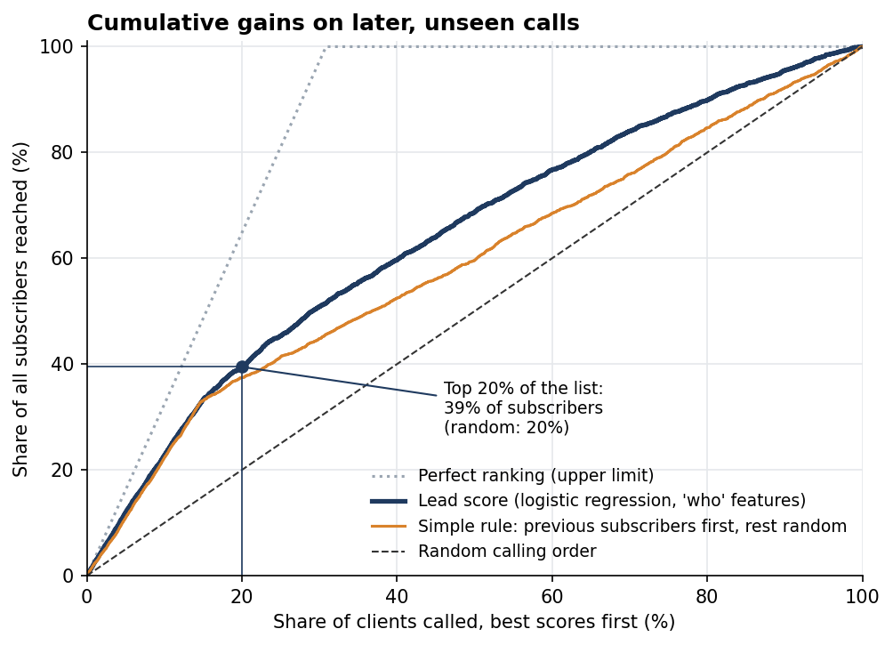
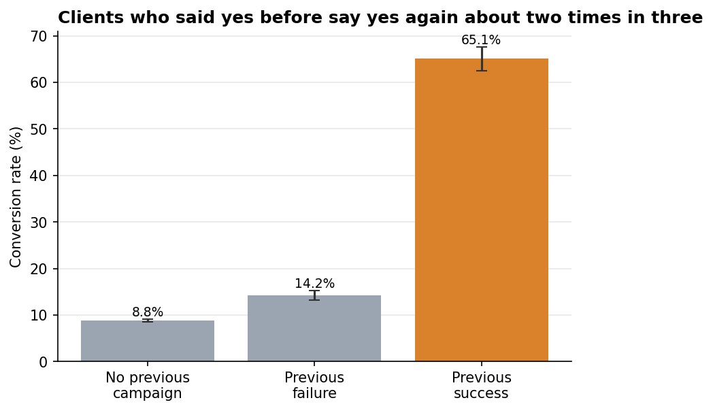
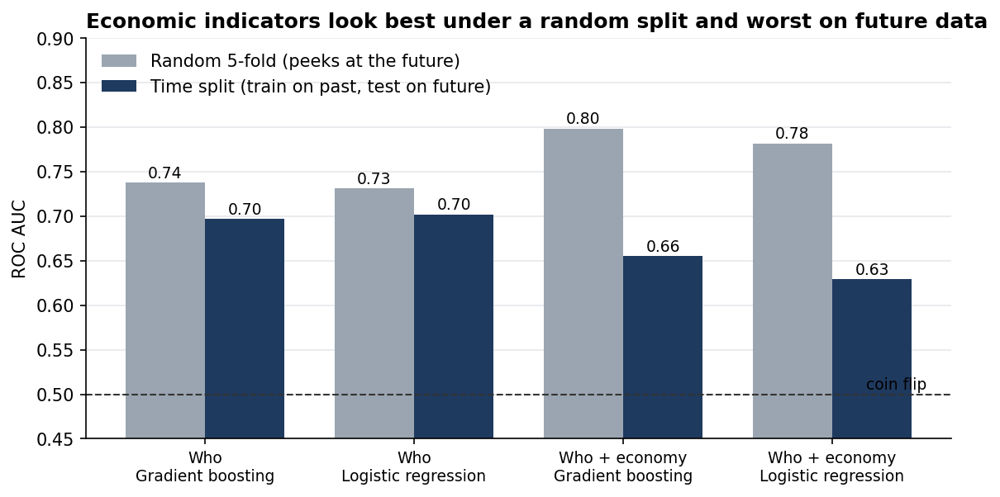
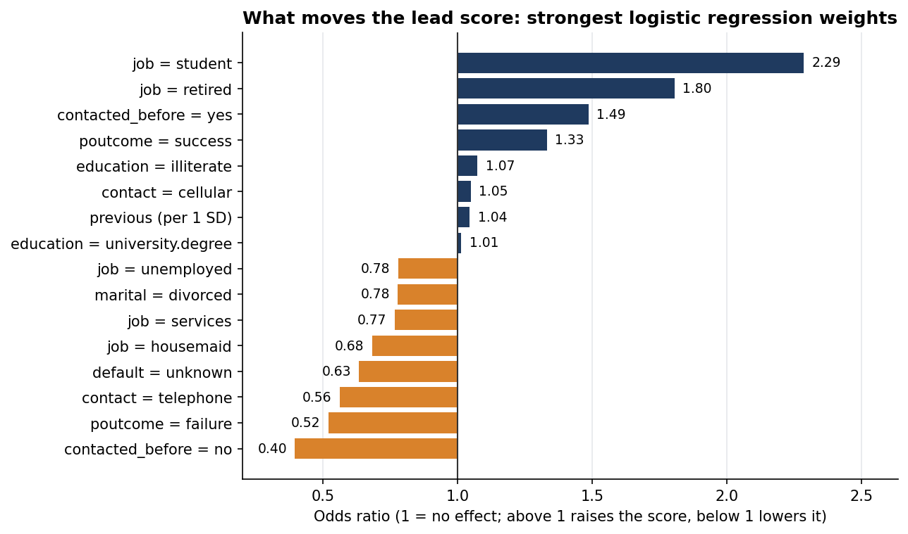

# Bank Marketing: Who to Call First (Statistics and Lead Scoring)

## Business question

The call centre can only phone a fraction of the client list. Who should be called first, and how much better is that than calling at random?

## Answer

This project uses real telephone-marketing records from a Portuguese bank (41,176 calls, May 2008 to November 2010, 4,639 subscriptions, 11.27% conversion) to build a lead score. The score ranks clients before the call, using only information known before dialling. Its results on the time-ordered test set, which holds the later calls the model never saw, are:

- **Calling the top 20% of the scored list reaches 39.5% of all subscribers** (lift 1.97; random calling reaches 20%). Calling the top 10% reaches 22.8% of subscribers (lift 2.28).
- **The top-scored decile converts at 70.1%**, against a test-set average of 30.8% and 13.9% for the bottom decile.
- **Most of the lift comes from one fact: whether the client subscribed in a previous campaign.** A one-line rule ("previous subscribers first, then everyone in random order") reaches 37.4% of subscribers in the top 20%. The model adds a modest improvement on top of it, mostly further down the list (50.9% against 44.8% at 30%).
- **The score is a ranking, not a probability.** It has a ROC AUC of 0.70 on the test set. The average predicted probability is 14.1% against an actual conversion rate of 30.8%, because the test period converted much more often than the training period.
- **Call duration is excluded.** It is only known after the call. Including it would report an AUC of 0.95 and a lift of 4.37, which cannot be achieved in practice.



*Cumulative gains on the time-ordered test set. The further the curve sits above the diagonal (random calling), the better the ranking.*

## Statistical findings

Notebook 01 tests four beliefs about conversion with proper tests and effect sizes. With 41,176 rows almost any difference is "statistically significant", so the effect size and the adjustment for time period are reported next to each p-value.

| Question | Raw result | Effect size | After adjusting for the economic period | Reading |
|---|---|---|---|---|
| Mobile vs landline contact | 14.7% vs 5.2% | +9.5 points; risk ratio 2.82; Cohen's h 0.33 | Odds ratio 3.13 falls to 2.86 (95% CI 2.57 to 3.18); mobile ahead in each year | Associated, and the direction holds in every year; the size varies by year |
| Previous campaign success vs none | 65.1% vs 8.8% | +56.3 points; risk ratio 7.4; Cramér's V 0.32 | Odds ratio 19.3 falls to 4.15 | Strongest signal; the raw figure overstates it |
| Previous campaign failure vs none | 14.2% vs 8.8% | Odds ratio 1.71 (unadjusted) | Odds ratio 0.65 | The direction reverses after adjustment, so the raw comparison is misleading |
| Number of calls to the same client | 13.0% on call 1; 3.6% on call 10 or more | 13% lower odds per extra call (odds ratio 0.871) | 5% lower odds per extra call (odds ratio 0.950) | A real trend, smaller once the period is taken into account |
| Day of the week | 10.0% (Monday) to 12.1% (Thursday) | Cramér's V 0.025 (chi-square p = 3.1e-05) | Not adjusted | Statistically significant but practically negligible |

Notebook 01 also shows conversion by year: 4.8% in 2008, 19.5% in 2009 and 52.1% in 2010. The years differ in market conditions and in the mix of contact channels, so the period is controlled for in each test.

## Charts



Clients with a previous campaign success converted at 65.1%, against 8.8% for clients who had no previous campaign.



The same model scores higher on a random split (lift 2.36 at 20%) than on the time-ordered test set (lift 1.97), so a random split overstates performance.



Odds ratios from the logistic regression: never-contacted clients and previous failures push the score down, while previous contact and some job groups push it up. These are weights inside one model, not causal effects.

## Method

1. **Data preparation.** The 41,188 rows were checked for exact duplicates; 12 were removed, leaving 41,176 rows. The text value "unknown" is kept as its own category rather than guessed. The file has no year column, so the year was recovered from the date order of the rows and used only to describe periods.
2. **Feature choice.** Each column was checked against one rule: is it known before the phone is picked up? Client profile, contact channel and previous-campaign history qualify. Call duration does not. The `pdays` column, where 999 means "never contacted", became a yes/no column.
3. **Time-ordered split.** The first 80% of calls (32,940, May 2008 to May 2009, 6.4% conversion) were used for training. The last 20% (8,236 calls, May 2009 to November 2010, 30.8% conversion) were held back as the test set.
4. **Models.** A logistic regression (explainable: each feature has one weight) and a gradient-boosting model were compared. The simpler logistic regression scored best on the test set, so it is the lead score.
5. **Metrics.** Accuracy is not used, because always predicting "no" scores 88.7%. The metrics judge the ranking: ROC AUC, the share of subscribers reached in the top 20% and lift.
6. **Robustness checks.** A random 5-fold cross-validation and a rolling time-based test were run for comparison. The rolling test shows the performance is specific to the later period.

## What makes this analysis trustworthy

- **(a) Call duration is excluded.** The length of a call is only known after it ends, and the call outcome is known then too. The dataset's own notes say it should be discarded for a realistic model. It appears in one labelled cell (notebook 02, section 8) to show how large the leakage would be, and in no other model.
- **(b) Time-ordered validation, and an honest comparison of the two scores.** A random split lets a model learn from calls made in the same weeks as the calls it is scored on. For the logistic regression with the economic indicators, the random split gives an AUC of 0.78 and a lift of 3.04; on the time-ordered test set the same kind of model gives an AUC of 0.63 and a lift of 1.89. For that reason the economic indicators are left out of the final score. The 0.70 headline is also specific to the later period: in the rolling test, the early folds score close to a coin flip (AUC 0.44 to 0.62).
- **(c) Effect sizes matter more than p-values.** Every test in notebook 01 has a p-value below 0.001, including day of the week, which has a Cramér's V of 0.025. The effect size shows which differences are worth acting on.
- **(d) The data is observational.** Nobody randomly assigned clients to a channel or a number of calls. The results are associations. Showing that a channel causes more subscriptions would need an experiment.

The profit scenario in notebook 02 (section 10) uses **assumed** call costs and subscription values. The dataset contains no cost or revenue information. The scenario only illustrates the method; the bank's own figures would replace the assumptions.

## Project structure

```
bank-marketing-lead-scoring/
  README.md                          this case study
  requirements.txt                   Python packages with minimum versions
  .gitignore
  data/
    bank-additional-full.csv         the raw data (semicolon separated)
    bank-additional-names.txt        the official notes from the data source
    README.md                        data dictionary, source and licence
  notebooks/
    01_statistical_tests.ipynb       statistical tests and effect sizes
    02_lead_scoring_model.ipynb      lead score, validation, cumulative gains
  images/                            the PNG charts used in this README
```

## How to run (Windows, VS Code)

1. Install Python 3.10 or newer from python.org and install the Python and Jupyter extensions in VS Code.
2. Open the `bank-marketing-lead-scoring` folder in VS Code (File, Open Folder).
3. Open a terminal in VS Code and create a virtual environment:
   ```
   python -m venv .venv
   .venv\Scripts\activate
   pip install -r requirements.txt
   ```
4. Open `notebooks/01_statistical_tests.ipynb`, select the `.venv` Python interpreter as the kernel, and choose **Run All**. Then do the same for `notebooks/02_lead_scoring_model.ipynb`.

The notebooks read the data with relative paths (`../data`), so they run from the `notebooks` folder without editing. Running them also rewrites the PNG charts in `images/` under the same names.

## Limitations

- **Old data, one bank, one country.** The calls were made from May 2008 to November 2010 by one Portuguese retail bank. The results may not hold for other banks, countries or years.
- **A financial-crisis period.** Interest rates fell sharply during the data period, and conversion rose from about 5% to over 50%. The later period is much easier to predict than the early one.
- **Observational data.** The associations do not prove cause and effect (see section above).
- **Reconstructed year.** The year was inferred from the order of the rows, not read from a date column.
- **Final call counts.** Each row stores the total number of calls to a client. Clients who subscribe are not called again, so the call-count effect mixes persistence with the difficulty of the client.
- **Moderate predictive power.** An AUC of 0.70 orders clients usefully but does not predict individual outcomes reliably.
- **Before any real use**, re-train and re-test the model on current data, with the bank's own costs and values, and re-check the scores against recent outcomes.

## Data source and licence

- **Dataset:** Bank Marketing (with social and economic context), file `bank-additional-full.csv`, UCI Machine Learning Repository, dataset 222.
- **Licence:** Creative Commons Attribution 4.0 International (CC BY 4.0). Reuse is allowed, including commercially, with attribution.
- **Citation:** Moro, S., Cortez, P., Rita, P. (2014). A data-driven approach to predict the success of bank telemarketing. *Decision Support Systems*, 62, 22-31. https://doi.org/10.1016/j.dss.2014.03.001
- The economic indicators in the file come from the Banco de Portugal statistics published with the dataset.
